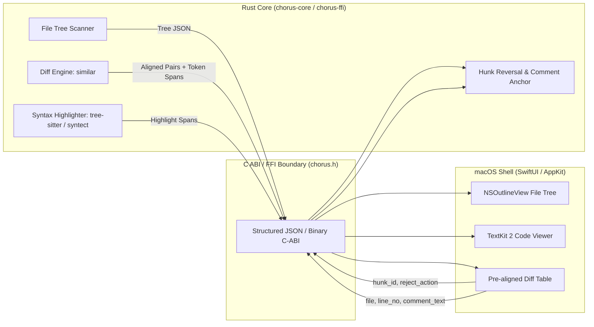
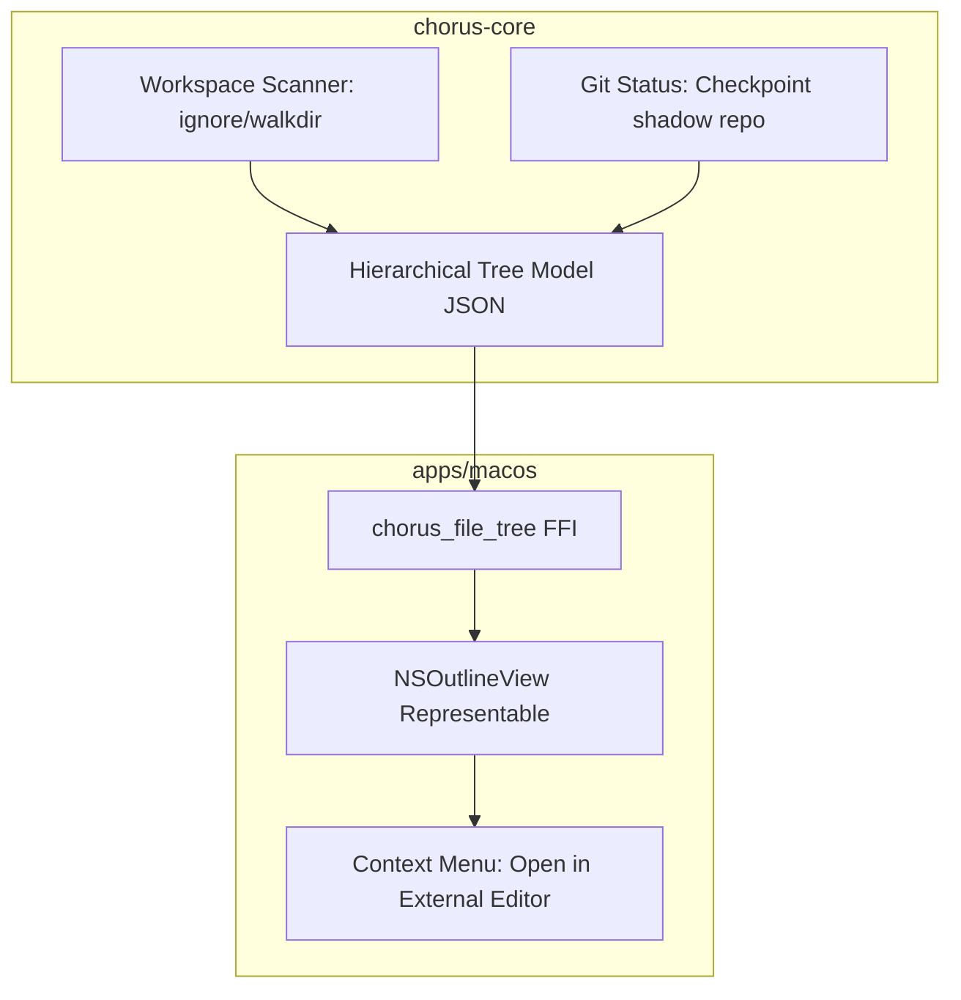
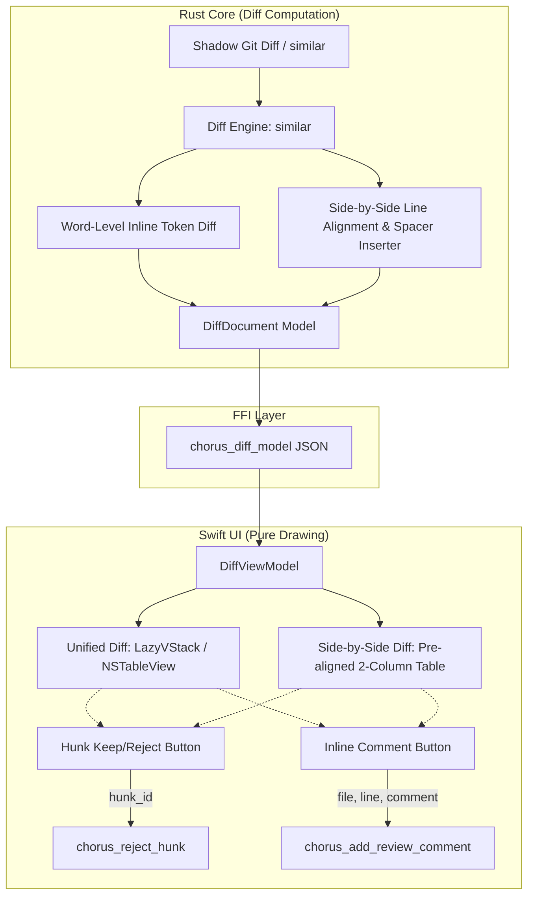

# macOS Code and Diff Rendering Components Research

**Ticket:** `.scratch/chorus-harness-roadmap/issues/08-macos-code-and-diff-components.md`  
**Date:** October 2026  
**Status:** Complete  

---

## 1. Executive Summary & Recommended Architecture

Chorus is evolving into a desktop agent harness where users review, inspect, and approve multi-agent code changes natively on macOS. In alignment with **CLAUDE.md Rule 2.3 ("No logic in Swift")**, the core application logic—including file system scanning, git diff computation, line alignment, token-level diffing, and syntax highlighting spans—must reside entirely in the **Rust core (`chorus-core` / `chorus-ffi`)**. Swift is restricted to rendering UI and dispatching user inputs (view-first, no in-app IDE editing).

### The Recommended Component Stack

| Subsystem | Engine / Logic (Rust Core) | UI / Presentation (Swift / AppKit) | Rationale & Architectural Fit |
|---|---|---|---|
| **File Tree** | Workspace directory traversal (`walkdir` / `ignore`) + Git status detection (`Checkpoint` / shadow repo). Emits hierarchical JSON. | `NSOutlineView` wrapped in SwiftUI via `NSViewRepresentable`. | `NSOutlineView` uses cell recycling to virtualize 50,000+ files with zero jank (unlike SwiftUI `OutlineGroup` which exhibits high CPU and rendering bugs in large trees, as evidenced by CodeEdit). |
| **Code Viewer (Read-only)** | Rust `syntect` (TextMate grammars) or `tree-sitter` crate. Parses source into styled span intervals `(byte_start, byte_end, scope_class)`. | AppKit `NSTextView` backed by **TextKit 2** (or `STTextView` configured read-only). | Viewport-virtualized text layout, native 120Hz scrolling, native selection, full VoiceOver accessibility, dark/light mode dynamic NSColors, and zero SPM syntax parser overhead in Swift. |
| **Unified & Side-by-Side Diff** | Rust `similar` crate (`TextDiff`) + AST/word diffing. Pre-computes unified lines, token-level inline diffs, and side-by-side line pairs with alignment spacer lines. | Native SwiftUI `LazyVStack` or AppKit `NSTableView` rendering pre-aligned rows. | Pre-calculating alignment spacers in Rust eliminates fragile dual-scroll synchronization in Swift. Hunk reverse-patching and inline review comment anchoring remain 100% in Rust. |

---

## 2. Requirements Analysis

Chorus is a **view-first** desktop agent harness, not a full IDE (as decided in `map.md`):
1. **File Tree**:
   - Collapsible folders with smooth hierarchy.
   - Git status indicators: Added (`+`), Modified (`M`), Deleted (`D`), Untracked (`U`).
   - Filter/search bar.
   - "Open in External Editor" (VS Code, Zed, Cursor, Xcode) via `NSWorkspace.shared.open`.
2. **Code Viewer**:
   - Read-only viewing of source files with accurate syntax highlighting across dozens of languages (Rust, Swift, TypeScript, Python, Go, C++, Markdown, YAML, JSON, SQL, etc.).
   - Fast initial render and low memory footprint for large files (>10,000 lines).
   - Dynamic dark/light mode theme support.
   - Native macOS clipboard copy, text selection, and keyboard navigation.
3. **Unified and Side-by-Side Diff Viewer**:
   - Clear visual differentiation of additions, deletions, and context lines.
   - Word/character-level inline highlights within modified lines.
   - Collapsible hunks with stable IDs and standalone patches for granular "Keep" / "Reject" ("เก็บ" / "ตีกลับ") actions.
   - Review loop: Inline comment anchors on any diff line to send actionable feedback back to the agent turn loop.
   - Side-by-side mode: Perfectly synchronized horizontal and vertical scrolling with visual spacer blocks when line counts differ between base and modified buffers.

---

## 3. The Core Constraint: CLAUDE.md Rule 2.3 ("No Logic in Swift")

> *"ห้ามมี logic ใน Swift — เราทำ macOS ก่อน แต่ทุก logic อยู่ใน Rust และคุยกับ UI ผ่าน event stream ทางเดียว Swift ทำแค่วาดกับรับ input เพื่อให้วันที่เริ่มทำ WinUI 3 ไม่ต้องแก้ core แม้แต่บรรทัดเดียว"*

In Chorus today, `apps/macos/Sources/Chorus/ContentView.swift` (lines 2240–2335) contains:
- `DiffHunk` and `parseHunks(_ diff: String)`: An ad-hoc Swift regex/string parser that splits `engine.workingDiff` into file headers, `@@` lines, and body strings.
- `HunkView`: A rudimentary SwiftUI `VStack` capped at `lines.prefix(60)`, lacking side-by-side mode, word-level diffing, or syntax highlighting.

This violates Rule 2.3 and creates three critical failure modes:
1. **Portability Loss**: When building WinUI 3 (Windows) or a remote headless daemon, the entire diff parsing, hunk splitting, and hunk rejection system would have to be reimplemented from scratch in C# or TypeScript.
2. **Performance Regression**: Swift regex and string slicing over multi-megabyte git diffs stalls the main SwiftUI thread.
3. **Data Loss & Bug Surface**: Swift ad-hoc diff parsing struggles with binary diffs, renames, mode changes, and multiline hunk headers, causing silent drops or corrupt patch construction.

### The Pure Contract Between Rust and Swift



---

## 4. Evaluation of Candidate Technologies

### 4.1 tree-sitter: Rust Core vs. Swift Bindings

- **Tree-sitter via Rust Core (`tree-sitter`, `tree-sitter-highlight` crates)**
  - *Architecture:* Parsing and queries run in Rust background worker threads. Rust parses the document and outputs an array of non-overlapping highlight spans: `HighlightSpan { start_byte: usize, end_byte: usize, scope: ScopeId }`. Swift simply maps `ScopeId` to native `NSColor` attributes on `NSTextStorage`.
  - *Rule 2.3 Fit:* **100% compliant**. Identical highlighting engine powers macOS, future Windows (WinUI 3), and headless web APIs.
  - *Performance:* Very fast, incremental parsing, zero Swift main-thread blockage.
  - *License:* MIT.
  - *Downside:* Bundling C/Tree-sitter grammars into the Rust binary requires build scripts (`cc` crate) or precompiled parser objects.
- **Tree-sitter via Swift Bindings (`SwiftTreeSitter`, `CodeEditLanguages`)**
  - *Primary Sources:* [ChimeHQ/SwiftTreeSitter](https://github.com/ChimeHQ/SwiftTreeSitter), [CodeEditApp/CodeEditLanguages](https://github.com/CodeEditApp/CodeEditLanguages).
  - *Architecture:* Swift compiles dozens of SPM packages containing C Tree-sitter grammars and runs the AST query engine in Swift via `SwiftTreeSitterLayer`.
  - *Rule 2.3 Fit:* **Violates Rule 2.3**. Locks highlighting logic into Swift.
  - *Maintenance & Build Times:* Pulls dozens of external SPM dependencies into Xcode / `Package.swift`, drastically slowing down Swift build times.
  - *License:* MIT.

### 4.2 Highlightr

- *Primary Source:* [raspu/Highlightr](https://github.com/raspu/Highlightr).
- *Mechanism:* Swift wrapper around `highlight.js` running inside Apple's `JavaScriptCore` runtime. Generates HTML and converts it back to `NSAttributedString` using a custom regex HTML parser.
- *Performance:* **Poor**. High latency (~50ms for 500 lines on modern hardware, degrades severely above 2,000 lines). High memory overhead from JavaScriptCore VM.
- *Maintenance:* Effectively unmaintained / abandonware. Outdated `highlight.js` bundle.
- *Rule 2.3 Fit:* **Violates Rule 2.3**.
- *Verdict:* **Disqualified**.

### 4.3 Splash

- *Primary Source:* [JohnSundell/Splash](https://github.com/JohnSundell/Splash).
- *Mechanism:* Lightweight, pure Swift syntax highlighter designed by John Sundell for Swift code blogs and static site generators.
- *Language Support:* **Swift only**. Does not support Rust, TypeScript, Python, Go, C++, JSON, or shell scripts.
- *Rule 2.3 Fit:* **Violates Rule 2.3**.
- *Verdict:* **Disqualified** (unusable for a multi-language agent harness).

### 4.4 Runestone

- *Primary Source:* [simonbs/Runestone](https://github.com/simonbs/Runestone) by Simon B. Støvring.
- *Mechanism:* Performant plain-text code editor framework written for iOS and iPadOS subclassing `UITextView`.
- *Platform Support:* **iOS / iPadOS only**. Does not provide a native macOS AppKit implementation (only experimental Mac Catalyst, which maintainers explicitly advise against for native macOS desktop apps).
- *Verdict:* **Disqualified** (Chorus is a native AppKit/macOS application).

### 4.5 STTextView

- *Primary Source:* [krzyzanowskim/STTextView](https://github.com/krzyzanowskim/STTextView) by Marcin Krzyżanowski.
- *Mechanism:* Modern macOS AppKit text view built from the ground up on Apple's **TextKit 2** (`NSTextLayoutManager`, `NSTextContentStorage`).
- *Features:* Built-in line numbers gutter, multi-cursor, invisible characters, high-performance virtualized viewport layout.
- *Performance:* Excellent. Viewport virtualization guarantees instantaneous scrolling even on 100,000+ line files.
- *Theming & Dark Mode:* Complete support for AppKit dynamic colors (`NSColor`), system light/dark mode changes, font scaling, and custom color themes.
- *Accessibility:* Full native `NSAccessibility` and VoiceOver support via TextKit 2.
- *License:* MIT.
- *Maintenance Health:* Highly active, modern Swift 5.9+, robust community adoption.
- *Fit with Rust Core:* **Excellent**. When configured read-only (`isEditable = false`), it accepts pre-calculated attributed strings or highlight spans from Rust.

### 4.6 CodeEditSourceEditor / CodeEditTextView

- *Primary Source:* [CodeEditApp/CodeEditSourceEditor](https://github.com/CodeEditApp/CodeEditSourceEditor).
- *Mechanism:* Xcode-inspired code editor for macOS built on TextKit 2 (`CodeEditTextView`) and `SwiftTreeSitter`.
- *Features:* Code completion, folding, minimap, bracket matching, inline diagnostics, gutter git change indicators.
- *Drawbacks for Chorus:*
  1. Highly coupled to the CodeEdit ecosystem (`CodeEditLanguages`, `SwiftTreeSitter`). Brings heavy SPM dependency trees into `Package.swift`.
  2. Bakes grammar parsing and tokenization into Swift (violating Rule 2.3).
  3. Tailored for interactive IDE file editing rather than lightweight view-first inspection and multi-file diff reviews.
- *License:* MIT.

### 4.7 WKWebView + Shiki or Monaco Read-Only Diff Viewer

- *Mechanism:* Embedding a `WKWebView` to run a local HTML/JS bundle using [Shiki](https://shiki.style) (VS Code's TextMate engine in WASM) or Microsoft's [Monaco Editor](https://microsoft.github.io/monaco-editor/) (`monaco.editor.createDiffEditor`).
- *Advantages:*
  - Monaco provides the world's most battle-tested side-by-side diff UI: token-level diffing, collapsible unchanged regions, inline minimap, and diff navigation out-of-the-box.
- *Disadvantages:*
  1. **Memory & Process Overhead:** Spawns a dedicated WebKit `WebContent` process consuming 40–80 MB RAM per instance. Unsuitable for multiple embedded diff widgets inside chat messages or multi-file review lists.
  2. **Non-Native Feel & Sluggishness:** Non-native scrollbar physics, non-native selection handles, font rendering discrepancies compared to native AppKit views.
  3. **Complex Communication:** Synchronizing hunk keep/reject clicks and inline review comments requires fragile `WKScriptMessageHandler` IPC bridges.
  4. **Theming Desync:** Requires listening for macOS `AppleInterfaceThemeChangedNotification` and dispatching JS messages to swap CSS themes.
- *License:* MIT (both Shiki and Monaco).

---

## 5. Comprehensive Evaluation Matrix

| Component / Technology | Primary Engine Language | Performance (Large Files / Diffs) | Theming & Dark Mode | Accessibility & Native Feel | Maintenance Health | License | Fit with Rule 2.3 (Logic in Rust) | Verdict |
|---|---|---|---|---|---|---|---|---|
| **tree-sitter (Rust Core)** | Rust / C | **Exceptional** (Incremental, SIMD, background thread) | **Universal** (Rust outputs scope tags; UI applies palette) | **Full Native** (Drawn by AppKit TextKit 2) | Very Active (Official Tree-sitter) | MIT | **Perfect** (Cross-platform core) | **Recommended (Core)** |
| **tree-sitter (Swift bindings)** | Swift / C | High | Native | Full Native | Active (`SwiftTreeSitter`) | MIT | **Fails** (Grammars & queries trapped in Swift) | Not Recommended |
| **syntect (Rust Core)** | Rust | **Exceptional** (TextMate, compiled pack, fast regex) | **Universal** (Bundled Sublime / TextMate themes) | **Full Native** (Drawn by AppKit TextKit 2) | Active / Battle-tested (Bat, Delta) | MIT | **Perfect** (Zero C dependencies in build) | **Recommended Alternative (Core)** |
| **Highlightr** | Swift / JS | Poor (High latency, JS bridge overhead) | Fragile | Native wrapper around HTML | Abandoned | MIT | **Fails** (Logic in Swift/JS) | **Disqualified** |
| **Splash** | Swift | High (for Swift only) | Native | Full Native | Semi-active | MIT | **Fails** (Swift only, logic in Swift) | **Disqualified** |
| **Runestone** | Swift | High (on iOS) | Native iOS | iOS / UIKit only | Active | MIT | **Fails** (No native macOS/AppKit support) | **Disqualified** |
| **STTextView** | Swift / AppKit | **Exceptional** (TextKit 2 viewport virtualization) | Native `NSColor` dynamic theming | Full `NSAccessibility` & VoiceOver | Very Active | MIT | **Perfect** (Dumb view for Rust spans) | **Recommended (Code View UI)** |
| **Native NSTextView (TextKit 2)** | Swift / AppKit | **Exceptional** (System TextKit 2) | System dynamic theming | System baseline | Apple Platform SDK | Apple SDK | **Perfect** (Zero external Swift dependencies) | **Recommended (Code View UI)** |
| **CodeEditSourceEditor** | Swift | High | Native | Full Native | Active | MIT | **Fails** (Coupled to SwiftTreeSitter IDE logic) | Not Recommended |
| **WKWebView + Monaco Diff** | JS / WebKit | Moderate (WebKit process memory bloat) | Requires JS/CSS sync | WebKit accessibility, non-native scroll | Very Active (Microsoft) | MIT | **Partial** (Diff logic in Monaco, high overhead) | Not Recommended for Desktop Shell |

---

## 6. How Reference Applications Render Diffs

### 6.1 Zed (`zed-industries/zed`)
- **UI Framework:** Custom GPU-rendered UI framework in Rust (**GPUI**) rendering directly to Metal on macOS.
- **Diff Architecture:** **Multi-buffer architecture**. Diff views are composed of buffer slices rendered in a unified continuous surface.
- **Split Diff Alignment:** Uses a Rust `BlockMap` that calculates and inserts visual **spacer blocks** between lines to lock unchanged lines between the left (base) and right (working copy) buffers.
- **Diff Calculation:** Implemented completely in Rust using high-speed diffing algorithms and Tree-sitter highlighting.
- **Key Lesson for Chorus:** Computing alignment spacers in Rust eliminates the need for complex, buggy two-way scroll synchronization in Swift.

### 6.2 CodeEdit (`CodeEditApp/CodeEdit`)
- **UI Framework:** Pure native Swift & SwiftUI/AppKit.
- **File Tree:** CodeEdit initially attempted using SwiftUI's `OutlineGroup` for its `ProjectNavigator`, but abandoned it after discovering severe performance bottlenecks and UI bugs in large repositories. They explicitly switched to **`NSOutlineView`**.
- **Code & Diff:** Uses `CodeEditTextView` with gutter indicators for git modifications. Reviewing multi-file diffs is still undergoing active development.
- **Key Lesson for Chorus:** Do not use `OutlineGroup` for project file trees; use `NSOutlineView` wrapped via `NSViewRepresentable`.

### 6.3 OpenAI Codex Desktop App
- **UI Framework:** Electron desktop shell wrapping a React frontend with a bundled Rust CLI / daemon backend.
- **Editor & Review:** Uses ProseMirror / custom web components with dedicated review panes.
- **Workflow:** Side-by-side or unified diff viewing, per-hunk stage/revert toggles, and **inline comments on diff lines** that feed directly back into the AI agent prompt loop.
- **Key Lesson for Chorus:** The review feedback loop (inline commenting on diff lines to prompt the agent) is the killer UX feature for agent harnesses. Chorus can deliver this with native macOS speed and zero Electron memory overhead.

---

## 7. Recommended Architecture & Detailed Design for Chorus

### 7.1 Component 1: File Tree (Workspace Navigator)



1. **Rust Engine (`chorus-core`):**
   - Traverse workspace using `ignore::WalkBuilder` (honors `.gitignore`, `.chorus/`, `.git/`).
   - Query git status against the checkpoint base: clean, modified (`M`), added (`+`), deleted (`D`), untracked (`?`).
   - Expose via FFI `chorus_file_tree(engine)` returning:
     ```json
     {
       "name": "root",
       "path": "/",
       "is_dir": true,
       "children": [
         { "name": "src", "path": "src", "is_dir": true, "git_status": "clean", "children": [...] },
         { "name": "main.rs", "path": "src/main.rs", "is_dir": false, "git_status": "modified" }
       ]
     }
     ```
2. **Swift Presentation (`apps/macos`):**
   - Wrap `NSOutlineView` in SwiftUI via `NSViewRepresentable`.
   - Cell recycling guarantees 60/120 FPS scrolling on 50,000+ files.
   - SF Symbols for file types + macOS system colors for git badges (e.g. orange for modified, green for added).
   - "Open in External Editor" button (`NSWorkspace.shared.open(url)` or user-configured editor).

---

### 7.2 Component 2: Code Viewer (Read-Only)


1. **Rust Engine:**
   - Syntax highlighter crate: **`syntect`** (recommended for zero-build C dependency and bundled TextMate syntaxes/themes) or **`tree-sitter`**.
   - Input: `path` and `content`.
   - Output: Vector of highlight spans:
     ```rust
     pub struct HighlightSpan {
         pub start_byte: u32,
         pub end_byte: u32,
         pub color_rgba: u32, // or scope token type: Keyword, String, Type, Comment, etc.
     }
     ```
2. **Swift Presentation:**
   - AppKit `NSTextView` backed by **TextKit 2** (or `STTextView`) wrapped in `NSViewRepresentable`.
   - `isEditable = false`, `isSelectable = true`.
   - Gutter ruler for line numbers.
   - Swift applies `NSForegroundColorAttributeName` across `NSTextContentStorage` from the Rust spans.
   - Full native text selection, copy, find-in-buffer (`Cmd+F`), and VoiceOver accessibility.

---

### 7.3 Component 3: Unified & Side-by-Side Diff Viewer



#### The Rust Diff Data Contract
Rust computes the complete visual diff model, eliminating all parsing and alignment logic from Swift:

```rust
#[derive(Serialize)]
pub struct DiffDocument {
    pub files: Vec<DiffFileModel>,
}

#[derive(Serialize)]
pub struct DiffFileModel {
    pub file_path: String,
    pub old_path: Option<String>,
    pub status: String, // "modified", "added", "deleted"
    pub additions: usize,
    pub deletions: usize,
    pub hunks: Vec<DiffHunkModel>,
}

#[derive(Serialize)]
pub struct DiffHunkModel {
    pub id: String, // Stable hash of file + header
    pub header: String, // "@@ -12,7 +12,9 @@"
    pub patch: String, // Standalone patch for reverse apply
    pub unified_lines: Vec<DiffLineModel>,
    pub side_by_side_pairs: Vec<SideBySidePairModel>,
}

#[derive(Serialize)]
pub struct DiffLineModel {
    pub origin: char, // ' ', '+', '-'
    pub old_lineno: Option<usize>,
    pub new_lineno: Option<usize>,
    pub content: String,
    pub inline_spans: Vec<InlineHighlightSpan>, // Character/word-level changes
}

#[derive(Serialize)]
pub struct SideBySidePairModel {
    pub left: Option<DiffLineModel>,  // None indicates a spacer line
    pub right: Option<DiffLineModel>, // None indicates a spacer line
}
```

#### Why Pre-Aligned `SideBySidePairModel` Solves Split Diffs
In traditional split diff implementations, two independent text views must have their scroll offsets programmatically synchronized, which causes stutter, line height drift, and alignment glitches when multiline code wraps.

By computing `SideBySidePairModel` in Rust:
- If lines 10–12 were added on the right, Rust inserts 3 spacer rows where `left = None` and `right = Some(DiffLine)`.
- Swift renders a single table or `LazyVStack` where each row displays:
  ```swift
  HStack(spacing: 0) {
      HalfLineView(line: pair.left)
          .frame(maxWidth: .infinity)
      Divider()
      HalfLineView(line: pair.right)
          .frame(maxWidth: .infinity)
  }
  ```
- **Result:** Scrolling is inherently unified and 100% synchronized with zero math or race conditions in Swift.

#### Review Loop Integration (Inline Comments)
- On hover, each line displays a `+` button in the gutter.
- Clicking opens an inline comment field anchored to `(file_path, lineno, hunk_id)`.
- Swift sends `{ "file": file_path, "line": lineno, "comment": text }` through `chorus_add_review_comment`.
- Rust appends this as a review event to the session ledger (`EventKind::ReviewComment`), which is automatically incorporated into the next turn's prompt context when the user tells the agent to proceed.

---

## 8. Migration Plan for Chorus

1. **Phase 1: Rust Core Diff Engine (Deprecate Swift Parsing)**
   - Add `similar` crate to `Cargo.toml`.
   - Implement `DiffDocument` builder in `crates/chorus-core/src/checkpoint.rs`.
   - Expose `chorus_working_diff_model` in `crates/chorus-ffi/src/lib.rs`.
   - Delete `parseHunks` and ad-hoc diff slicing from `apps/macos/Sources/Chorus/ContentView.swift`.
2. **Phase 2: Highlighting Engine in Rust**
   - Add `syntect` or `tree-sitter-highlight` to `chorus-core`.
   - Expose `chorus_highlight_file(path, content)` in FFI.
   - Update `HunkView` and Code Viewer to apply Rust token spans to `NSAttributedString`.
3. **Phase 3: Side-by-Side and Virtualized Diff UI**
   - Add split-view toggle (Unified vs. Side-by-Side) in macOS toolbar.
   - Implement `SideBySideDiffView` using pre-aligned pair rows.
4. **Phase 4: File Tree Navigator**
   - Implement `chorus_file_tree` in Rust (`walkdir` + git status).
   - Add `NSOutlineView` sidebar navigator in macOS shell with "Open in External Editor" action.
5. **Phase 5: Inline Diff Review Comments**
   - Add line-level comment popovers on diff rows.
   - Wire comments to `chorus-core` review event queue to complete the agent review loop.

---

## 9. Citations & Primary Sources

1. **Tree-sitter**: Official Tree-sitter Parser System & Grammars. [github.com/tree-sitter/tree-sitter](https://github.com/tree-sitter/tree-sitter) (MIT License).
2. **SwiftTreeSitter**: Swift bindings for Tree-sitter by ChimeHQ. [github.com/ChimeHQ/SwiftTreeSitter](https://github.com/ChimeHQ/SwiftTreeSitter) (MIT License).
3. **similar**: Sequence Diffing Library for Rust by Armin Ronacher. [docs.rs/similar](https://docs.rs/similar) (Apache-2.0 / MIT License).
4. **syntect**: Rust library for syntax highlighting using Sublime Text syntax definitions. [docs.rs/syntect](https://docs.rs/syntect) (MIT License).
5. **STTextView**: Performant TextKit 2 text view for macOS by Marcin Krzyżanowski. [github.com/krzyzanowskim/STTextView](https://github.com/krzyzanowskim/STTextView) (MIT License).
6. **CodeEdit**: Native macOS code editor project. [github.com/CodeEditApp/CodeEdit](https://github.com/CodeEditApp/CodeEdit), `CodeEditSourceEditor` [github.com/CodeEditApp/CodeEditSourceEditor](https://github.com/CodeEditApp/CodeEditSourceEditor) (MIT License).
7. **Zed Editor Architecture**: Multi-buffer and split diff alignment in Rust GPUI. [zed.dev/blog](https://zed.dev) and [github.com/zed-industries/zed](https://github.com/zed-industries/zed) (GPL/Apache-2.0).
8. **Runestone**: Plain text editor for iOS by Simon B. Støvring. [github.com/simonbs/Runestone](https://github.com/simonbs/Runestone) (MIT License).
9. **Highlightr**: Syntax highlighter using JavaScriptCore. [github.com/raspu/Highlightr](https://github.com/raspu/Highlightr) (MIT License).
10. **Splash**: Swift syntax highlighter by John Sundell. [github.com/JohnSundell/Splash](https://github.com/JohnSundell/Splash) (MIT License).
11. **Monaco Editor**: The code editor that powers VS Code. [github.com/microsoft/monaco-editor](https://github.com/microsoft/monaco-editor) (MIT License).
12. **Apple TextKit 2 Documentation**: `NSTextLayoutManager`, `NSTextContentStorage`, `NSOutlineView`. [developer.apple.com](https://developer.apple.com/documentation/uikit/textkit_2).
