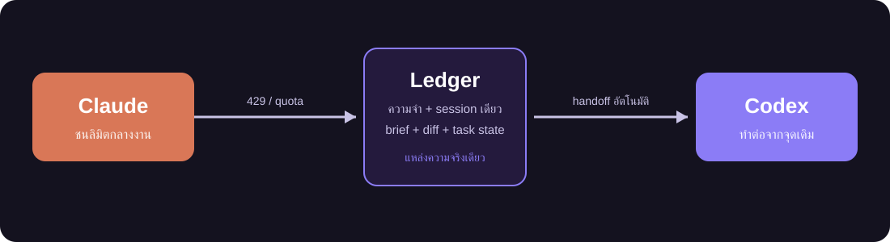

<p align="center">
  
</p>

<p align="center">
  <a href="https://github.com/PerthTheIamCat/chorus/releases/latest"></a>
  
  
  
</p>

**Chorus** คือแอป desktop (macOS) ที่ให้ AI agent หลายเจ้า — **Claude, Codex, Antigravity** — ทำงานใน
**session เดียวกัน** ใช้ความจำก้อนเดียวกัน เห็น skill ชุดเดียวกัน และ **ส่งไม้ต่อกันได้กลางงาน**
เมื่อตัวใดตัวหนึ่งชนลิมิต

> dev ที่ใช้ AI หลายตัวไม่ได้เจ็บเพราะโมเดลไม่เก่ง แต่เจ็บเพราะ **บริบทขาดทุกครั้งที่เปลี่ยนเครื่องมือ**
> Chorus เก็บบริบททั้งหมดไว้ที่แอป ไม่ใช่ที่ provider — agent ตัวไหนมารับช่วงก็รู้ว่าเกิดอะไรขึ้นแล้ว

<p align="center">
  
</p>

## จุดเด่น

| | |
|---|---|
| 🔁 **ส่งไม้ต่อไร้รอยต่อ** | ชน 429 / quota แล้วสลับไป agent ตัวถัดไปเองพร้อม brief (เป้าหมาย · สิ่งที่ทำแล้ว · ข้อห้าม · diff) ไม่ต้องเล่าใหม่ |
| 🧠 **ความจำเดียว session เดียว** | ledger (SQLite) เป็นแหล่งความจริง ไม่ผูกกับ session ของ provider — provider พังไป ประวัติยังอยู่ครบ |
| ⚖️ **เทียบ agent** | ส่งโจทย์เดียวให้หลายเจ้า แต่ละตัวทำใน git worktree ของตัวเอง เทียบเวลา · token · ค่าใช้จ่าย · diff ได้ก่อนเลือก |
| 🧭 **วางแผนก่อนลงมือ** | plan mode อ่านโค้ดอย่างเดียว (บังคับด้วย sandbox จริง) แล้วค่อยกด "ทำตามแผน" |
| ⏪ **ย้อนได้ทั้งแชทและไฟล์** | คลิกขวาที่ข้อความ แล้วย้อนไปก่อนจุดนั้น — ไม่ลบอะไร แตก session ใหม่ให้ |
| 🔍 **รีวิว diff ทีละ hunk** | keep/reject รายก้อน · ตรวจด้วย language server · commit · push · เปิด PR ในแผ่นเดียว |
| 🛡️ **ปลอดภัยเป็นค่าเริ่มต้น** | Seatbelt sandbox กัน agent เขียนนอก workspace · กัน secret หลุด 3 ชั้น (mask / inject / block) |
| 🧩 **ตั้งค่าที่เดียว ใช้ทุกเจ้า** | skill, MCP config และ memory เขียนครั้งเดียว แล้วฉายให้ `CLAUDE.md` / `AGENTS.md` / skill ของแต่ละเจ้า |
| 📥 **นำเข้า session เก่า** | ดึงบทสนทนาจาก Claude Code / Codex / Gemini CLI มาคุยต่อกับ agent ตัวไหนก็ได้ |
| 💻 **เทอร์มินัลในตัว** | PTY จริง (zsh login) หลายแท็บ ครอบ sandbox ได้ |

อื่น ๆ: repo map ใน context ทุกเทิร์น · browser ผ่าน extension ของแต่ละเจ้า · computer use (ปิดไว้เป็นค่าเริ่มต้น) ·
System Monitor · แจ้งเตือนเมื่อเทิร์นจบ · อัปเดตตัวเองด้วย Sparkle — ดูครบใน [CHANGELOG.md](CHANGELOG.md)

## ภาพตัวอย่าง

<!--
  TODO(screenshots): ใส่ภาพจริงของแอปไว้ที่ docs/images/ แล้วแทนบล็อกนี้ด้วย
    
  ภาพที่ควรมี: หน้าแชทหลาย agent (มี handoff) · แผง Changes · หน้าเปรียบเทียบ agent · Settings
-->

_ภาพหน้าจอแอปกำลังจะตามมา_ — ระหว่างนี้ลองรันเดโมในเครื่องได้เลย (ไม่ต้องมี API key):

```bash
cargo run -p chorus-cli --bin chorus -- demo
```

เดโมจะเล่าทั้งเรื่องด้วย agent ปลอม: agent ตัวแรกชนลิมิตกลางงาน แล้วตัวที่สองรับช่วงต่อโดยรู้เป้าหมาย ข้อห้าม และไฟล์ที่แตะแล้ว

## ติดตั้ง

**ความต้องการ:** macOS 14 ขึ้นไป · agent อย่างน้อยหนึ่งเจ้าที่ login ไว้แล้ว (`claude`, `codex` หรือ `agy`)

1. ดาวน์โหลด `Chorus-x.y.z.dmg` ล่าสุดจาก [Releases](https://github.com/PerthTheIamCat/chorus/releases/latest)
2. เปิด dmg แล้วลาก **Chorus** ไปไว้ใน `Applications`
3. เปิดครั้งแรกตามหัวข้อด้านล่าง (แอปยังไม่ได้ notarize)
4. รอบถัดไปแอปอัปเดตตัวเองผ่าน [Sparkle](https://sparkle-project.org/) — ตรวจจาก feed ใน GitHub Releases และตรวจลายเซ็น EdDSA ก่อนติดตั้ง

### เปิดแอปที่ยังไม่ notarize (Gatekeeper)

เพราะ Chorus ยังไม่ได้ลงนามด้วย Apple Developer ID macOS จะขึ้นว่า "ไม่สามารถตรวจสอบได้" ตอนเปิดครั้งแรก — เป็นเรื่องปกติของแอปที่ไม่ผ่าน notarize เลือกอย่างใดอย่างหนึ่ง:

- **ผ่านหน้า Settings:** เปิดแอปหนึ่งครั้งให้ถูกบล็อก → **System Settings › Privacy & Security** → เลื่อนลงเจอ "Chorus was blocked" → **Open Anyway**
- **หรือผ่าน Terminal:**
  ```bash
  xattr -dr com.apple.quarantine /Applications/Chorus.app
  ```

ทำครั้งเดียวต่อเวอร์ชันที่ติดตั้งเอง การอัปเดตผ่าน Sparkle ในแอปไม่ต้องทำซ้ำ

### Build เอง

ต้องมี Rust 1.85+ และ Xcode toolchain (Swift 5.9+)

```bash
git clone https://github.com/PerthTheIamCat/chorus && cd chorus
apps/macos/build.sh                              # build core + แอป + เปิด
cargo run -p chorus-cli --bin chorus -- doctor   # ดูว่า agent ไหนพร้อมใช้
```

## ผลการทดสอบ

วัดบน Linux (container) เมื่อ 25 ต.ค. 2026 บน `main` — **ยังไม่ได้รันซ้ำบน macOS ในรอบนี้** · CI บน macOS รัน test / clippy / bench / swift ทุก push และ PR

| | ผล |
|---|---|
| `cargo test --workspace` | **469 ผ่าน · 6 ล้ม** — 6 ตัวที่ล้มต้องใช้ Seatbelt (macOS เท่านั้น) และตั้งใจปฏิเสธเมื่อไม่มี sandbox ([CLAUDE.md §7.22](CLAUDE.md)) |
| `chorus bench` | invariant ผ่านครบ (ด้านล่าง) |
| เทสต์กับ agent จริง | `scripts/smoke-real-agents.sh` ผ่านบน Mac: claude / codex / antigravity เขียนไฟล์ได้ · agent ตัวที่สองรู้งานของตัวแรกจาก ledger · ตัวหนึ่งพัง → relay ไปอีกตัว (20 ต.ค. 2026) |

**`chorus bench`** (session 78 events — ตัวเลขที่ห้ามถอยหลัง):

| วัด | ผล |
|---|---|
| อ่านไฟล์เดิม 8 ครั้ง | เก็บ blob **1 แถว** (ไม่ dedup = 8) — ประหยัด **99.6%** |
| context @ หน้าต่าง 200k | ledger ดิบ 103,553 token → ส่งเข้าโมเดล **16,226 token (15.7%)** |
| context @ หน้าต่าง 6k | **2,490 token (2.4%)** — ย่อ 40 ข้อความ ทิ้ง 11 (ย่อก่อนทิ้งเสมอ) |
| handoff ในเทิร์นถัด ๆ ไป | **10 token** ต่อเทิร์น (เดิม ~8,000 สำหรับ diff 300 บรรทัด) |
| ประกอบ context | **16 ms** — ไม่เรียก summariser บนเส้นทางของเทิร์น |
| ขนาดดิสก์ | 176 KB / 78 events |

ตัวเลข `chorus-eval` Tier 1 ส่วน metrics เป็นการจำลอง ไม่ใช่ผลวัดจริง (ดู [CLAUDE.md §7.24](CLAUDE.md))

```bash
cargo test --workspace
cargo run -p chorus-cli --bin chorus -- bench
```

## หลักคิด 3 ข้อ

1. **storage ≠ context** — ดิสก์ปรับให้ไบต์น้อย/query เร็ว ที่ส่งเข้าโมเดลปรับให้ token น้อย ประกอบใหม่ทุกครั้ง ไม่เขียนกลับดิสก์
2. **ledger เป็นแหล่งความจริงเดียว** — provider เป็นแค่ผู้ถูกเรียกมาตอบหนึ่งเทิร์น
3. **ห้ามมี logic ใน Swift** — ทุกอย่างอยู่ใน Rust, UI คุยผ่าน FFI/event stream เพื่อให้พอร์ตไป Windows ได้โดยไม่แก้ core

## โครงสร้างโปรเจกต์

```
crates/chorus-core/    ledger, blob, memory, context assembler, handoff, checkpoint, compaction, …
crates/chorus-acp/     ACP client, bridge ของแต่ละเจ้า, sandbox, PTY
crates/chorus-cli/     คำสั่ง `chorus` + Session engine
crates/chorus-ffi/     C ABI (chorus.h) ที่ SwiftUI shell ลิงก์
crates/chorus-daemon/  chorusd headless engine
crates/chorus-eval/    harness eval
apps/macos/            SwiftUI shell
evals/handoff/         eval คุณภาพการส่งไม้ต่อ
docs/                  ref/ (design, storage spec), adr/, agents/
```

## สถานะและแผน

เวอร์ชันปัจจุบัน **v0.2.x** (macOS) — ดูรายการเปลี่ยนแปลงใน [CHANGELOG.md](CHANGELOG.md)

ยังไม่มี: Windows (WinUI 3) · notarize · agent เพิ่ม (Gemini CLI, โมเดล local)

## สำหรับผู้ร่วมพัฒนา

บริบทเต็ม ข้อตัดสินใจ และกับดักที่เคยเหยียบอยู่ใน [CLAUDE.md](CLAUDE.md) และ [CONTEXT.md](CONTEXT.md) —
อ่านก่อนแก้ core (โดยเฉพาะ ledger, context assembler และ sandbox)
